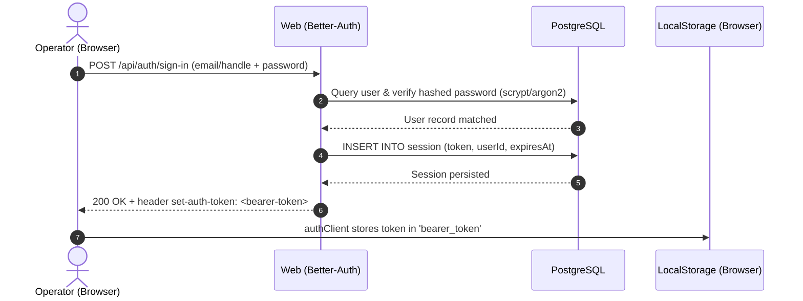
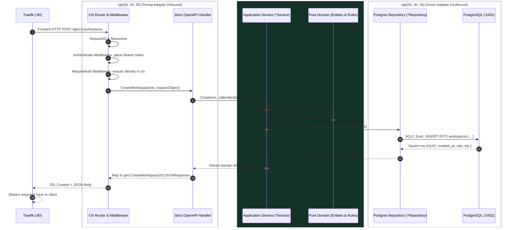
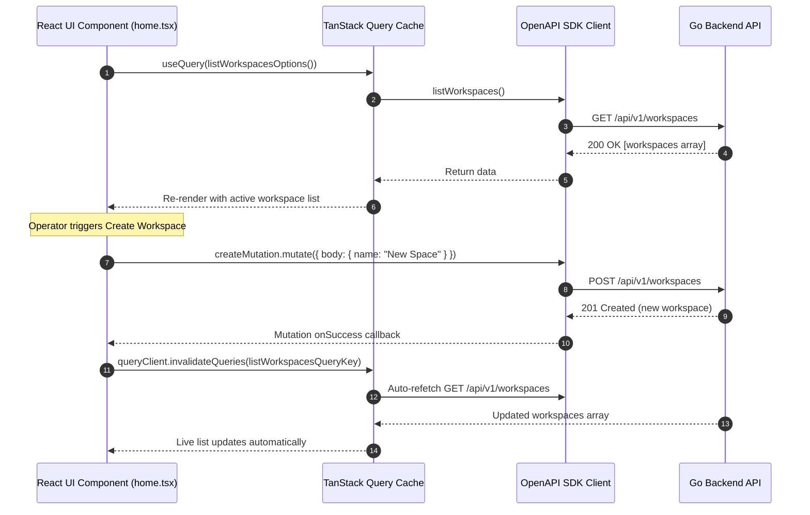

# Kizen Request Flow Architecture

This document provides a comprehensive, layer-by-layer breakdown of how requests traverse the Kizen system—from client-side triggers and edge routing to internal Go Hexagonal pipelines, database persistence, and client reactivity.

---

## 1. System Topology & Edge Routing (Traefik)

All ingress traffic reaches the host on ports `:80` (HTTP) and `:8080` (Traefik Dashboard). Traefik acts as the reverse proxy gateway, dispatching requests based on prefix rules defined in `docker-compose.yaml`:

```mermaid
flowchart TD
    Client["Client (Browser / SPA / CLI)"]
    Traefik["Traefik Reverse Proxy (:80)"]

    subgraph Internal Docker Network [kizen-internal]
        API["services/api (:8080)<br/>Go Hexagonal Backend"]
        Web["services/web (:3000)<br/>TanStack Start + Better-Auth"]
        DB[(services/database :5432<br/>PostgreSQL 18)]
    end

    Client -->|HTTP Request| Traefik
    Traefik -->|PathPrefix('/api/v1') or PathPrefix('/api/health')| API
    Traefik -->|PathPrefix('/api/auth') or PathPrefix('/')| Web
    API -->|pgxpool connection| DB
    Web -->|pg connection pool| DB
```

### Route Rules Table

| Target Path | Ingress Filter | Destination Service | Handling Engine |
| :--- | :--- | :--- | :--- |
| `/api/health` | Priority: 100 | `kizen-api:8080` | Go Chi standard healthcheck endpoint |
| `/api/v1/*` | Priority: 100 | `kizen-api:8080` | Go Chi Strict OpenAPI REST endpoints |
| `/api/auth/*` | Priority: 1 | `kizen-web:3000` | Better-Auth Node/Bun server endpoint handler |
| `/*` (All other) | Priority: 1 | `kizen-web:3000` | TanStack Start SSR & Vite React SPA |

---

## 2. Authentication & Session Flow (Better-Auth)

Kizen uses **Better-Auth** with the `bearer` and `username` plugins to handle identity. 



### Key Mechanisms:
1. **Token Retrieval**: On sign-in, the Better-Auth client plugin intercepts the `set-auth-token` HTTP response header and saves it to `localStorage.getItem("bearer_token")`.
2. **Token Injection**: `services/web/src/lib/api.ts` installs an interceptor onto the Hey-API fetch client:
   ```ts
   client.interceptors.request.use((request) => {
       const token = localStorage.getItem("bearer_token");
       if (token) {
           request.headers.set("Authorization", `Bearer ${token}`);
       }
       return request;
   });
   ```
3. **Route Guarding**: TanStack Router `beforeLoad` hooks (`services/web/src/routes/_authenticated.tsx`) evaluate session validity before rendering protected UI layouts, redirecting unauthenticated operators to `/authenticate`.

---

## 3. Go API Hexagonal Request Flow (`services/api`)

Every incoming request to `/api/v1/*` passes through the standard Go Hexagonal Architecture.



### Layer Details:

#### 1. Inbound Ingress & Middleware Pipeline (`internal/transport/http`)
- **`chiMiddleware.RequestID`**: Injects or creates a unique request correlation ID into `r.Context()`.
- **`chiMiddleware.Recoverer`**: Traps unexpected panics, logs the stack trace, and writes an RFC 7807 500 Problem Detail response.
- **`middleware.Authenticate(authenticator)`**:
  - Inspects the `Authorization` header for `Bearer <token>`.
  - Passes the raw token string to `ports.Authenticator.Authenticate(ctx, token)`.
  - Injects the resulting `*auth.Identity` (`UserID`, `Email`) into context via `WithIdentity(ctx, identity)`.
- **`middleware.RequireAuth()`**:
  - Protects all `/api/v1/*` routes.
  - If no `Identity` exists in the request context, halts the pipeline with an RFC 7807 `401 Unauthorized` response.

#### 2. Strict OpenAPI Driving Adapter (`internal/transport/http/handler`)
- Handlers implement `gen.StrictServerInterface` generated by `oapi-codegen`.
- Request bodies are deserialized and strongly typed according to `contracts/openapi.yaml`.
- Handlers extract caller identity from context via `middleware.IdentityFromContext(ctx)`.
- Handlers call the appropriate application use case method and map errors to typed RFC 7807 problem responses (e.g., `gen.CreateWorkspace400ApplicationProblemPlusJSONResponse`).

#### 3. Application Use Cases & Ports (`internal/application/workspace`)
- The `*Service` struct orchestrates the business operation:
  ```go
  func (s *Service) Create(ctx context.Context, caller auth.Identity, input domainWorkspace.CreateInput) (*domainWorkspace.Workspace, error)
  ```
- Enforces owner isolation by passing `caller.UserID` into domain structures.
- Consumes the outbound port `ports.WorkspaceRepository`, remaining completely agnostic of the database driver or SQL implementation.

#### 4. Pure Domain Core (`internal/domain/workspace`)
- Zero external imports (no `net/http`, no `database/sql`, no SQLC).
- Contains business validation (e.g. rate cannot be negative, name cannot be blank).
- Emits lowercase sentinel errors: `ErrInvalidInput`, `ErrNotFound`, `ErrDuplicateName`.

#### 5. Driven Outbound Adapter (`internal/repository/postgres`)
- Implements `ports.WorkspaceRepository` with compile-time assertion:
  ```go
  var _ ports.WorkspaceRepository = (*Repository)(nil)
  ```
- Uses parameterized SQL queries generated by **SQLC** (`services/api/internal/repository/postgres/gen`).
- Manages connection lifecycle via `pgxpool.Pool` with bounded max/min connections.

---

## 4. Lifecycle of Specific Operations

### Flow A: Creating a Workspace (`POST /api/v1/workspaces`)

1. **Client**: Frontend form calls `createWorkspaceMutation.mutate({ body: { name: "Acme", default_hourly_rate: 100 } })`.
2. **Network**: Traefik strips no path, forwards `/api/v1/workspaces` directly to `api:8080`.
3. **Auth**: `middleware.Authenticate` validates the bearer token, attaching `auth.Identity{UserID: "usr_xxx"}` to context.
4. **Validation**: OpenAPI schema confirms `name` is present and `default_hourly_rate >= 0`.
5. **Execution**:
   - `workspace.Service` assigns a new UUID `uuid.New()`, sets timestamps `time.Now().UTC()`, and attaches `OwnerID`.
   - `repoPostgres.Create` executes `INSERT INTO workspaces (id, owner_id, name, default_hourly_rate, description, created_at, updated_at) VALUES ($1, $2, $3, $4, $5, $6, $7)`.
6. **Response**: HTTP `201 Created` with full `Workspace` JSON payload.
7. **Frontend Invalidation**: On success, TanStack Query calls `queryClient.invalidateQueries({ queryKey: listWorkspacesOptions().queryKey })`, triggering an automatic refresh of the workspace list.

### Flow B: Listing Workspaces (`GET /api/v1/workspaces`)

1. **Client**: TanStack Query runs `useQuery(listWorkspacesOptions())`.
2. **Auth**: Identity is verified via Bearer token.
3. **Query**: SQL executed:
   ```sql
   SELECT id, owner_id, name, default_hourly_rate, description, created_at, updated_at
   FROM workspaces
   WHERE owner_id = $1
   ORDER BY created_at DESC;
   ```
4. **Response**: HTTP `200 OK` with JSON array of workspaces belonging exclusively to the authenticated user.

### Flow C: Deleting a Workspace (`DELETE /api/v1/workspaces/{id}`)

1. **Client**: Operator clicks delete button -> calls `deleteWorkspace({ path: { id } })`.
2. **Execution**: `repoPostgres.Delete(ctx, ownerID, workspaceID)` issues scoped delete:
   ```sql
   DELETE FROM workspaces
   WHERE id = $1 AND owner_id = $2;
   ```
3. **Response**: HTTP `204 No Content`. If no row was deleted, returns `404 Not Found`.

### Flow D: Not Found (404) Handling

1. **Unregistered Routes**: If an operator navigates to an undefined web route (e.g. `/unknown-sector`), TanStack Router's `defaultNotFoundComponent` catches the dispatch.
2. **Rendering**: Renders `services/web/src/components/not-found.tsx` within the shell layout, displaying the error telemetry and direct return paths to `/home` or `/authenticate`.
3. **API Unmatched Routes**: Chi router returns a standard 404 Problem Detail for unknown backend endpoints.

---

## 5. Database Schema & Dual Ownership

The PostgreSQL instance (`kizen-postgres-v3`) hosts two logical domain models in a single shared database:

```
+-------------------------------------------------------------------------+
|                           PostgreSQL (kizen)                            |
|                                                                         |
|  [Better-Auth Managed Tables]             [Kizen Core Domain Tables]    |
|  - user (id, name, email, createdAt)      - workspaces (id, owner_id,   |
|  - session (id, token, userId, expiresAt)               name, rate, ...) |
|  - account (id, userId, password, ...)    - tickets (id, workspace_id,  |
|  - verification (id, identifier, value)              title, status, ...) |
+-------------------------------------------------------------------------+
```

- **Authentication Tables**: Created via Better-Auth migrations (`services/database/migrations/*_create_better_auth.sql`).
- **Domain Tables**: Created via schema migrations (`services/database/migrations/*_create_workspaces.sql`).
- **Data Isolation**: All workspace and ticket queries strictly enforce tenant boundaries using `owner_id = caller.UserID`.

---

## 6. Frontend Client Reactive Cycle


